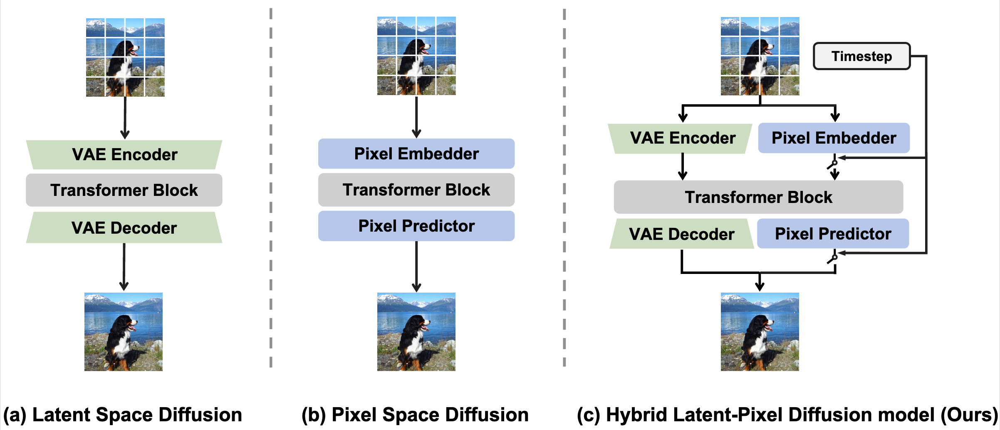

# Hi-DiT: Hybrid Latent-Pixel Diffusion Transformer for Image Generation

Hi-DiT bridges latent-space and pixel-space diffusion in a single Diffusion Transformer. The latent stream provides efficient semantic planning in a compact VAE latent space, while a time-gated pixel stream is activated in the low-noise regime to recover high-frequency details. This hybrid design keeps the optimization stability of latent diffusion while retaining direct access to pixel-level information for fine-detail synthesis.

<p align="center">
  
</p>

## News

- **2026-06**: Hi-DiT is accepted by ECCV 2026.
- Code for ImageNet class-conditional training, sampling, and FID evaluation is released.

## Highlights

- **Hybrid latent-pixel denoising**: a parameter-shared DiT backbone combines latent semantic modeling with pixel-level refinement.
- **Time-Gated Injection**: pixel tokens are injected only in the low-noise denoising regime, reducing capacity competition during early semantic formation.
- **High-Frequency Pixel Predictor**: a lightweight sub-pixel prediction head recovers fine textures from transformer features.

## Quantitative Results

### ImageNet 256x256

| Model | Type | Params | FID w/o CFG | IS w/o CFG | FID w/ CFG | IS w/ CFG |
| --- | --- | ---: | ---: | ---: | ---: | ---: |
| DiT-XL | Latent Diffusion | 675M | 9.62 | 121.5 | 2.27 | 278.2 |
| SiT-XL | Latent Diffusion | 675M | 8.61 | 131.7 | 2.06 | 270.3 |
| VA-VAE | Latent Diffusion | 675M | 2.17 | 205.6 | 1.35 | 295.3 |
| REPA | Latent Diffusion | 675M | 5.78 | 158.3 | 1.29 | 306.3 |
| PixelDiT | Pixel Diffusion | 797M | - | - | 1.61 | 292.7 |
| JiT-G | Pixel Diffusion | 2B | - | - | 1.82 | 292.6 |
| **Hi-DiT** | Latent + Pixel | 689M | **1.66** | **213.6** | **1.06** | 296.6 |
## Installation

```bash
git clone <this-repo-url>
cd Hi-DiT

conda env create -f environment.yml
conda activate hidit
```

## Data Preparation

The ImageNet training pipeline expects preprocessed HDF5 images and cached VAE latents.

### Download model weights
Before training the model, please download the weights for VAE and the weights for the pre-trained ImageNet model (optional) from the link: https://huggingface.co/shenhen/Hi-DiT.

### 1. Convert ImageNet Images to HDF5

```bash
python preprocessing.py \
    --imagenet-path /path/to/imagenet/train \
    --output-path data/imagenet256 \
    --resolution 256 \
    --num-workers 32
```

The output directory will contain:

```text
data/imagenet256/images.h5
data/imagenet256/images_h5.json
```

### 2. Cache VAE Latents

```bash
accelerate launch --num_machines=1 --num_processes=8 cache_latents.py \
    --data-dir data/imagenet256 \
    --output-dir data/imagenet256 \
    --vae-arch f16d32 \
    --vae-ckpt-path pretrained/e2e-vavae/e2e-vavae-400k.pt \
    --vae-latents-name e2e-vavae-400k \
    --pproc-batch-size 128
```

The training loader will then use:

```text
data/imagenet256/e2e-vavae-400k.h5
data/imagenet256/e2e-vavae-400k_h5.json
```

## Training

Hi-DiT uses two training stages.

### Stage 1: LDM-Only Latent Backbone Training

The pixel branch is disabled and the model is optimized with latent denoising and representation-alignment losses.

```bash
accelerate launch --num_machines=1 --num_processes=8 train.py \
    --ldm-only \
    --max-train-steps 400000 \
    --report-to wandb \
    --allow-tf32 \
    --mixed-precision fp16 \
    --seed 0 \
    --data-dir data/imagenet256 \
    --batch-size 256 \
    --path-type linear \
    --prediction v \
    --weighting uniform \
    --model SiT-XL/1 \
    --checkpointing-steps 50000 \
    --vae f16d32 \
    --vae-ckpt pretrained/e2e-vavae-400k/e2e-vavae-400k.pt \
    --vae-latents-name e2e-vavae-400k \
    --learning-rate 1e-4 \
    --enc-type dinov2-vit-b \
    --proj-coeff 0.5 \
    --encoder-depth 8 \
    --output-dir exps \
    --exp-name hidit-imagenet256-stage1-ldm-only
```

### Stage 2: Pixel-Branch Finetuning

Start from the stage-1 checkpoint and omit `--ldm-only`.  Because `train.py` keeps the resumed checkpoint step as `global_step`, set `--max-train-steps` to the desired total step count, not just the number of additional steps.

```bash
accelerate launch --num_machines=1 --num_processes=8 train.py \
    --resume-step 4000000 \
    --continue-train-exp-dir exps/hidit-imagenet256-stage1-ldm-only \
    --max-train-steps 4020000 \
    --report-to wandb \
    --allow-tf32 \
    --mixed-precision fp16 \
    --seed 0 \
    --data-dir data/imagenet256 \
    --batch-size 256 \
    --path-type linear \
    --prediction v \
    --weighting uniform \
    --model SiT-XL/1 \
    --checkpointing-steps 50000 \
    --vae f16d32 \
    --vae-ckpt pretrained/e2e-vavae-400k/e2e-vavae-400k.pt \
    --vae-latents-name e2e-vavae-400k \
    --learning-rate 1e-4 \
    --enc-type dinov2-vit-b \
    --proj-coeff 0.5 \
    --encoder-depth 8 \
    --output-dir exps \
    --exp-name hidit-imagenet256-stage2-pixel 
```

## Sampling

```bash
torchrun --nnodes=1 --nproc_per_node=8 generate.py \
    --exp-path exps/hidit-imagenet256-stage2-pixel \
    --train-steps 450000 \
    --sample-dir samples \
    --num-fid-samples 50000 \
    --pproc-batch-size 32 \
    --mode sde \
    --num-steps 50 \
    --cfg-scale 2.4 \
    --guidance-low 0.0 \
    --guidance-high 1.0 \
    --label-sampling equal \
    --skip-npz
```

The generated PNG folder will be printed at the end of sampling. Its name follows:

```text
samples/<exp_name>_<train_steps>_cfg<cfg>-<guidance_low>-<guidance_high>-labelsampling-<label_sampling>
```

## Evaluation

Use the standalone FID script with a generated image folder and a precomputed FID statistics file.

For ImageNet 256x256, this repository includes:

```text
imagenet_in256_stats.npz
```

Evaluate a generated folder:

```bash
python calculate_fid.py \
    --input-dir samples/hidit-imagenet256-stage2-pixel_0450000_cfg2.4-0.0-1.0-labelsampling-equal \
    --fid-stats imagenet_in256_stats.npz \
    --device cuda \
    --output-json results/hidit_imagenet256_450k_metrics.json
```

If you only need FID and want to skip Inception Score:

```bash
python calculate_fid.py \
    --input-dir /path/to/generated_png_folder \
    --fid-stats /path/to/fid_stats.npz \
    --no-isc
```

## Citation

```bibtex
@inproceedings{shen2026hidit,
  title     = {Hi-DiT: Hybrid Latent-Pixel Diffusion Transformer for Image Generation},
  author    = {Shen, Yedong and Li, Yehao and Pan, Yingwei and Zhang, Yanyong and Yao, Ting},
  booktitle = {European Conference on Computer Vision},
  year      = {2026}
}
```
